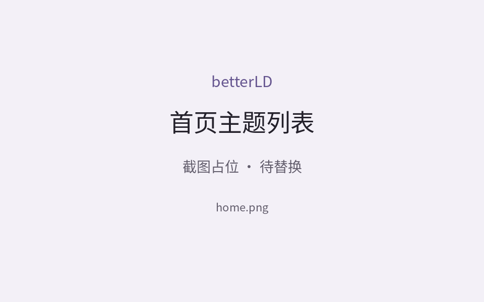
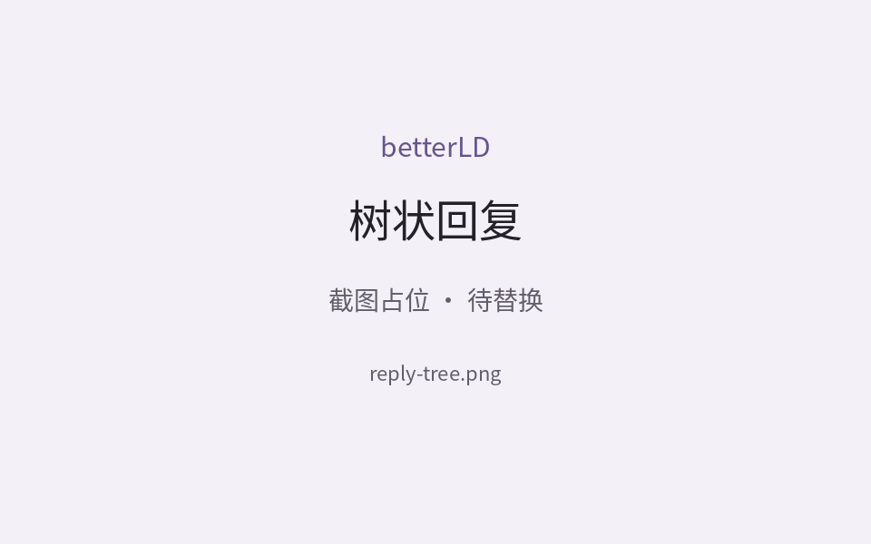
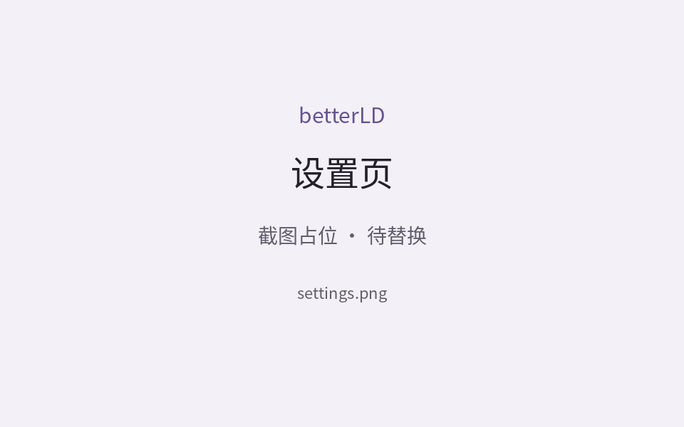

# betterLD

> 面向 [LinuxDo](https://linux.do/) 的浏览器美化与阅读增强扩展：Material 3 主题列表、树状回复、真实网页预览与可配置背景。

支持 **Chrome / Firefox 桌面端**，采用零运行时依赖的 Manifest V3，使用原生 JavaScript / CSS / HTML。

当前版本：**[v1.0.2](https://github.com/xMuelsysex/betterLD/releases/tag/v1.0.2)** · [更新日志](CHANGELOG.md)

## 效果预览

以下为截图占位图，真实界面截图待补充。

| 首页主题列表 | 树状回复 | 设置页 |
| --- | --- | --- |
|  |  |  |

## 核心功能

| 功能 | 可以做什么 |
| --- | --- |
| 原生列表美化 | 首页、搜索及帖底推荐共用 Material 3 条目，保留分类、标签、未读、置顶、排序和分页；可统一切回原站列表样式 |
| 树状回复 | 按真实回复关系组织多级讨论，支持分支收放、跳楼和双向续读；保留原站正文、媒体、引用、签名、回应、Boost 与楼层操作，可随时切换原帖回复 |
| 网页预览 | 从主题菜单手动打开真实 LinuxDo 网页，在预览内阅读回复树、切换帖子，关闭即卸载 |
| 外观定制 | 随机、内置、远程或本地壁纸，搭配页面遮罩、毛玻璃、主题色及明暗模式 |
| 稍后再看与收藏 | 本机保存主题和楼层，收藏支持文件夹、导入导出与 WebDAV 备份；阅读历史沿用 LinuxDo 原生「已读」 |
| 帖子导出 | 按主帖、全部回复、已加载回复或指定楼层导出 HTML、Markdown、PNG；HTML 可选择完全离线内嵌或远程引用 |
| 个人表情库 | 保存帖子图片、导入图片或 ZIP、分组管理静态图与动图，在发帖／回复编辑器中选图上传并插入草稿 |
| 筛选与私人标记 | 按标题、分类、标签、作者等规则筛选主题，给用户添加仅本机可见的短标签和备注 |
| 空搜索补充 | 可选 Bing / DuckDuckGo，在符合条件的站内空搜索中补充 LinuxDo 帖子，保留原帖及命中楼层链接 |

## 安装与快速上手

### 加载扩展

1. 下载 [当前版本源码](https://github.com/xMuelsysex/betterLD/archive/refs/tags/v1.0.2.zip)并解压，或克隆此仓库。
2. 在浏览器中加载包含 `manifest.json` 的目录：
   - **Chrome**：打开 `chrome://extensions` → 启用「开发者模式」→「加载已解压的扩展程序」→ 选择解压后的项目根目录。
   - **Firefox**：打开 `about:debugging#/runtime/this-firefox` →「临时载入附加组件」→ 选择项目根目录中的 `manifest.json`。临时附加组件在浏览器重启后需重新加载。
3. 打开或刷新 [LinuxDo](https://linux.do/)。

如果使用本地打包目录，则加载 `dist/betterLD/`（Firefox 选择其中的 `manifest.json`）。更新文件后，在扩展管理页重新载入**实际加载路径**的扩展，再刷新 LinuxDo 标签页；仅覆盖文件不会更新已打开页面的脚本与样式。

### 第一次使用

- **打开设置**：点击页面浮动「设置」按钮，或浏览器工具栏中的 betterLD 图标；两处均可调整设置，修改立即保存并生效。
- **调整外观**：设置 → 外观 → 壁纸，选择背景；设置 → 常规 → 表面与毛玻璃，开启「启用毛玻璃」并调整「表面模糊」。
- **阅读讨论**：进入主题默认显示树状回复。父楼按钮收放该楼的子分支，长竖线上的按钮收放后续同级回复；点击「原帖回复」切回原站视图，点击「树状回复」恢复树视图。
- **先看再打开**：在主题条目的菜单中选择「打开原帖预览」，手动打开网页预览；默认不会在列表滚动或悬停时请求正文。

## 常用入口

以下设置路径均从页面「设置」或工具栏 betterLD 弹窗进入，也可用设置页顶部搜索框定位。

| 想做什么 | 入口 |
| --- | --- |
| 切换列表外观 | 设置 → 页面 → 主题列表 → 列表样式，选择「美化后／美化前（原站样式）」 |
| 调整回复作者名称 | 设置 → 页面 → 树状回复 → 回复作者名称 |
| 改用抽屉打开主题 | 设置 → 组件 → 打开方式与抽屉 → 主题打开方式 |
| 保存稍后再看 | 主题条目旁「稍后再看」；点击浮动收藏库入口查看 |
| 收藏当前主题 | 帖子底部操作栏 → 收藏；浮动收藏库 → 收藏，可管理文件夹 |
| 导出帖子 | 帖底「导出」（页底未装载时位于标题块）；网页预览内也可使用 |
| 使用个人表情 | 发帖／回复编辑器工具栏 →「个人表情包」→「导入图片或 ZIP」；帖子图片右键 →「保存到表情包面板」 |
| 备份表情库或调整容量 | 设置 → 高级 → 表情包 |
| 开启外部搜索补充 | 设置 → 页面 → 搜索 → 外部搜索（站内无结果时），选择 Bing 或 DuckDuckGo 并授予访问权限；网页内提示授权时，点击「打开扩展授权页」完成 |
| 管理过滤规则 | 设置 → 页面 → 筛选 |
| 管理私人标签和备注 | 用户卡片中编辑；设置 → 页面 → 用户标记，启用或集中管理 |
| 备份设置、规则与收藏库 | 设置 → 高级 → 导入与导出；WebDAV 地址及备份操作位于「高级 → 同步与缓存」 |

### 导出与离线保存

在导出对话框选择格式与范围，指定楼层可写为 `1,3-8`。选择「已加载回复」只导出已有内容，不补读其他楼层；PNG 会按配置拆分长图。

- **HTML 完全离线内嵌**：默认方式，将头像、图片及可归档的媒体、附件内嵌到单文件。缺少资源权限时，到「设置 → 高级 → 导入与导出 → HTML 导出离线归档授权」授权所列域名，再返回帖子重新导出。资源下载失败、超限或遇到 B 站／YouTube 等无法直接归档的外部播放器时会明确停止，保留失败原因。
- **HTML 远程引用**：保留媒体地址，不下载资源；打开需联网，原帖删除或资源失效后媒体可能无法显示。
- **Markdown**：保留远程媒体链接。

HTML 文件不执行脚本；树视图导出保留父子连线，原帖视图导出保持平铺。

### 表情、收藏与外部服务

个人表情保存在本机，点击后先通过 LinuxDo 原站上传器上传，再插入草稿光标处，发帖仍由你确认；聊天暂不支持。Telegram 的 TGS 和视频贴纸需先转换为 GIF、WebP 等支持的图片格式。跨设备迁移使用表情库导入／导出。

收藏库中的「稍后再看／收藏」属于本机数据。树内原站书签操作成功后可镜像到本机收藏，本机删除收藏不会删除原站书签。

外部搜索**默认关闭**，仅在原站「相关结果」关闭、普通主题搜索完成且无结果时补充，AI 推荐不计入普通主题命中。启用后搜索词会发送给所选引擎，并追加 `site:linux.do`；结果只保留 LinuxDo 帖子。打开原站「相关结果」会收起补充面板。

## 开发说明

无需安装依赖或编译源码，可直接加载项目根目录；固定交付包通过以下命令生成：

```bash
npm run check   # JavaScript 语法检查
npm run package # 原位更新 dist/betterLD/
```

### 目录结构

```text
manifest.json             Chrome / Firefox 共用 Manifest V3 配置
betterld.config.js        运行参数与设置默认值的唯一来源
src/startup.js            提前读取设置并准备首屏外观
src/appearance.js         共用视觉 Token 与明暗配色
src/content.js/.css       原生列表、搜索、网页预览与树状回复
src/page-refresh.js       原站模型与组件桥接
src/topic-library.js/.css 本机稍后再看与收藏库
src/topic-export.js/.css  帖子导出与对话框
src/sticker-library.js    个人表情面板与图片管理
src/options.html/.js/.css 设置页及工具栏弹窗
```

运行参数集中于 `betterld.config.js`。原生列表保留站点节点，元信息只读已有预载和模型，不额外逐主题请求；树楼层与 Boost 正文复用原站 `PostCookedHtml`。插件自有网页预览使用同站 iframe，关闭时卸载。

- [产品契约与功能边界](CONTEXT.md)
- [开发、打包与发布约定](AGENTS.md)
- [实际功能、接口与架构审计](docs/architecture-interface-audit.md)

导出转换代码来自 [Linuxdo-Export-Markdown](https://github.com/kai-wei-kfuse/Linuxdo-Export-Markdown)，完整 MIT 声明保留在 `src/topic-export.js` 并随包分发。

## 友情链接

[LINUX DO](https://linux.do/)
